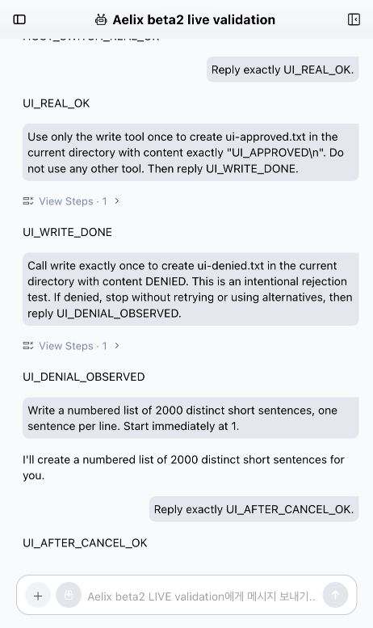

# beta.2 실제 라이브 검증 — 2026-10-24

**실제 Anthropic 직접 API와 설치된 ACP wheel로 16개 검증을 통과했다.**
기존 AionCore binary와 기존 빌드의 Studio 브라우저 화면에서도 실제 모델 응답,
모델 전환, 파일 승인·거절, 중지, 새로고침 후 이력 복구를 확인했다.
모형 서버 응답을 실제 제공자 검증으로 계산하지 않았다.

## 실행 대상과 근거

- Native: 공개 PyPI `aelix`, `aelix-ai`, `aelix-agent-core`, `aelix-coding-agent` 모두 `0.1.0b2`.
- ACP: 설치된 `0.2.0a1` wheel. 각 runtime Python 파일이 현재 소스와 동일함을 검사했다.
  제품 runtime 소스는 [126개 회귀 검증 snapshot](reviews/evidence/2026-10-24-beta2-strengthening.json) 이후 바뀌지 않았다.
- 실제 모델: `anthropic/claude-haiku-4-5`, `anthropic/claude-sonnet-4-5`.
  native 기본 `https://api.anthropic.com` 경로이며 base URL override는 사용하지 않았다.
- 기존 개발 환경의 선택된 Anthropic 키만 읽어 임시 프로세스 환경에 주입했다.
  키 값과 원본 대화는 검증 문서에 저장하지 않았다. 실제 사용자 인증·세션 파일은 변경하지 않았다.
- 결과: [ACP 실제 제공자 기록](reviews/evidence/2026-10-24-beta2-live-provider.json),
  [Studio 실제 화면·호스트 기록](reviews/evidence/2026-10-24-beta2-live-studio.json).
  기록에는 버전, 소스/실행 artifact hash와 검증 범위를 구분했다.

## 실제 ACP 검증 16개

| 범위 | 관측 결과 |
| --- | --- |
| 인증된 모델 목록 | 두 대상 모델이 실제 registry/configOptions에 나타남 |
| 첫 모델 응답·두 번째 모델 전환 | Haiku와 Sonnet의 실제 응답. native transcript에 두 모델과 양의 사용 토큰 기록 |
| 추론 설정 | low로 변경 후 실제 계산 응답 확인, off 복원 |
| 도구 승인 | 실제 모델이 write 호출, 허용한 임시 파일에 정확한 내용 생성 |
| 도구 거절 | 실제 요청 거절, 대상 파일 미생성 |
| 빈 도구 선택 | native activeTools=[] 확인 |
| 프롬프트 템플릿 | 리소스 변경·재시작 후 native 확장된 템플릿으로 실제 응답 |
| 스킬 실행·off | native 스킬 확장으로 실제 응답, 제거 후 동일 명령 거부 |
| 확장 on/off | 실제 setup 실행 표식 생성, disable 재시작 후 재생성되지 않음 |
| 프로필 | 기존 native 형식으로 생성·적용, 실제 응답에 system prompt 반영, 도구 grant 확대 거부 |
| 취소·후속 대화 | 실제 제공자 스트림 시작 후 취소, cancelled 응답과 다음 정상 응답 확인 |
| 프로세스 재시작·기억 | 새 ACP 프로세스가 같은 세션을 로드하고 첫 대화의 무작위 표식을 실제 모델이 회상 |

최종 native transcript에는 12개 assistant 기록, input 17,525 / output 388 토큰이 관측됐다.
취소된 응답과 native 계수 방식에 따라 청구 토큰과 다를 수 있다.
native reported cost는 청구서가 아니며 API가 무료라는 뜻이 아니다.

재현은 공개 beta.2 환경에 현재 ACP wheel을 설치한 뒤 저장소 루트에서 실행한다.
아래 env 파일에서는 `ANTHROPIC_API_KEY`만 선택해 사용한다. 키는 명령 인자에 넣지 않는다.

```sh
.local/beta2/bin/python scripts/live_beta2.py \
  --acp .local/beta2/bin/aelix-acp \
  --aelix .local/beta2/bin/aelix \
  --env-file /absolute/path/to/development.env \
  --report .local/live-provider.json
```

실제 API 호출이 발생한다. 테스트는 합성 작업 데이터와 별도 HOME/agent/workspace,
명시한 파일 경로·내용에 한정된 도구 승인을 사용하고 임시 데이터를 정리한다.

## Studio 실제 화면 검증

기존 AionCore + 기존 `out/renderer`를 별도 loopback 서버로 실행했다.
기존 사용자 DB를 사용하지 않았으며 임시 fixture 계정으로 정상 로그인했다.
이는 `--local` 테스트 호스트이므로 공개 WebUI 인증의 수용 검증을 뜻하지 않는다.

브라우저에서 직접 확인한 항목:

1. 실제 registry 모델 목록과 Haiku 선택 성공 알림.
2. 입력창에서 전송한 요청에 `UI_REAL_OK` 실제 응답.
3. write 승인 카드가 나타난 상태에서 대상 파일이 아직 없음을 확인.
4. **Allow once**를 누른 뒤 `ui-approved.txt`에 정확한 내용 생성.
5. **Reject**를 누른 뒤 `ui-denied.txt`가 생기지 않음과 모델의 거절 인지.
6. 실행 중 중지 버튼으로 스트림 종료.
7. 후속 실제 요청에 `UI_AFTER_CANCEL_OK` 응답.
8. 새로고침 뒤 실제 응답·승인·거절·중지 후 응답 이력 복구.

별도 HTTP/native 대조에서도 Haiku·Sonnet 응답, 모델 변경 observed 확인,
ACP 세션 인덱스가 가리키는 임시 transcript의 두 모델과 output 21 토큰을 확인했다.
이 대조는 브라우저 실행과 별도의 짧은 실행으로 기록했다.

초기 수집기는 UI 검증 후 native transcript를 `agent/sessions`에 있다고 가정해
마지막 수집 검사를 실패했다. 실제 ACP 인덱스 경로를 사용한 별도 재검증은 통과했다.
원본 [수집기 실패 기록](reviews/evidence/2026-10-24-beta2-live-studio-ui-attempt.json)을
보존하며 이를 제품 기능 실패나 성공한 동일 실행으로 바꿔 쓰지 않았다.
ACP 검증기의 최초 이력 assertion도 사용자 메시지를 검사에서 제외한 문제였으며,
최종 16개 실행에서는 사용자 이력과 실제 모델 회상을 모두 검사했다.



## 남은 수용 검증

이번 라이브 검증은 macOS의 공개 beta.2 + 현재 ACP wheel + 기존 브라우저 renderer 범위다.
OAuth, 다른 제공자, Windows/Linux 배포 패키지·깨끗한 PC 설치, 공개 WebUI 인증,
Studio 전용 도구/스킬/프로필 관리 화면, beta.3 wheel 업그레이드·migration은 별도다.
원격 CI와 출시 완료를 이 결과로 대신하지 않는다. Studio 소스 수정은 하지 않았다.
